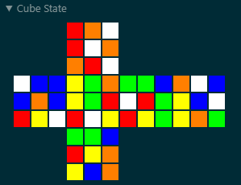

# rubiks-cube



La visualización anterior se genera con el siguiente código:

```lean
#widget cubeWidget (cubeStickerJson (R * B2 * D * L2 * B2 * R2 * B2 * D * F2 * U * R2 * D2 * R' * U' * B * F * L' * D2 * R * D' * U'))
```

## El proyecto, en breve

Este es un proyecto para la asignatura CS 1951x: Formal Proof and Verification. Se centra en utilizar Lean 4 para representar el Cubo de Rubik y demostrar diversos hechos sobre el cubo y el grupo matemático de los estados posibles del mismo (incluida una prueba de que los estados del cubo forman un grupo), así como en formalizar un algoritmo para resolverlo.

## Representación del cubo

Gran parte de este código está inspirado en [el repositorio rubiks-cube-group de kendfrey](https://github.com/kendfrey/rubiks-cube-group). Específicamente, modelé el Cubo de Rubik utilizando la misma división de información en piezas de esquina y piezas de arista, y luego en relación con las permutaciones y orientaciones de estos conjuntos de piezas. También copié el código del widget para mostrar los estados del cubo y lo adapté a Lean 4, haciéndolo compatible con la(s) representación(es) utilizada(s) aquí.

Experimenté con dos enfoques para representar las orientaciones de las piezas: vectores y funciones. Inicialmente solo usé vectores, pero descubrí que las funciones facilitaban la realización de ciertas pruebas. No obstante, he mantenido dos archivos separados para las definiciones basadas en vectores y las basadas en funciones, así como sus archivos de pruebas correspondientes. El archivo `SolutionAlgorithm.lean` utiliza la representación basada en funciones. Los archivos basados en funciones contienen comentarios que explican parte de su estructura, y los archivos basados en vectores reflejan la estructura de sus contrapartes basadas en funciones.

## Resolviendo el cubo

El enfoque utilizado en el algoritmo de solución se basa en el método Old Pochmann, que se explica en [este vídeo](https://youtu.be/ZZ41gWvltT8?si=H5LTXiRIMsc2TSEk) y en [este sitio web](https://www.speedcubereview.com/blind-solving-algorithms.html). Específicamente, implemento una versión que solo utiliza movimientos de preparación intuitivos en combinación con el T Perm para las aristas y el Altered Y Perm para las esquinas. Ten en cuenta que, dado que las aristas se resuelven primero, los movimientos de preparación de aristas pueden alterar las esquinas UBR y URF, ya que estas piezas no se están memorizando. Los movimientos de preparación de esquinas, sin embargo, están diseñados para no alterar las aristas UB y UL, las cuales intercambian de posición cada vez que se aplica el algoritmo Altered Y Perm.

## Agradecimientos

Me gustaría agradecer a [@jrr6](https://github.com/jrr6), [@robertylewis](https://github.com/robertylewis) y [@chenjulang](https://github.com/chenjulang) por su apoyo y orientación. Sin ellos, este proyecto no habría comenzado, y aún si lo hubiera hecho, muchas más de estas pruebas estarían incompletas.
